<!--
GitHub Profile README
Repository: https://github.com/krishnashukladev/krishnashukladev
IMPORTANT: Upload the "assets" folder along with this README — all SVGs live inside it.
-->

<!-- ============================ HERO ============================ -->

  

  
  
  

<!-- ============================ ABOUT ============================ -->

<!-- ============================ FOCUS ============================ -->

<!-- ============================ TECH STACK ============================ -->

<!-- ============================ ROADMAP ============================ -->

<!-- ============================ WHAT YOU'LL FIND ============================ -->

<!-- ============================ CONNECT ============================ -->

  <a href="https://krishnashukladev.netlify.app/">Portfolio</a> &nbsp;·&nbsp;
  <a href="https://www.linkedin.com/in/krishna-shukla-dev/">LinkedIn</a> &nbsp;·&nbsp;
  <a href="mailto:shuklakrishna360@gmail.com">Email</a> &nbsp;·&nbsp;
  <a href="https://github.com/krishnashukladev">GitHub</a>

